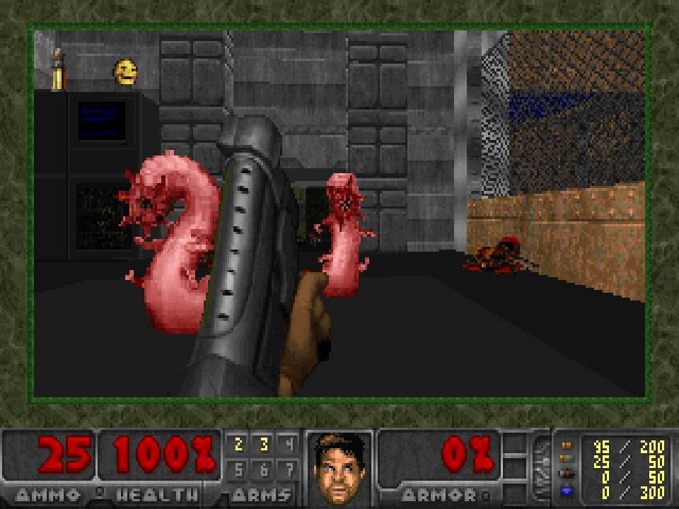
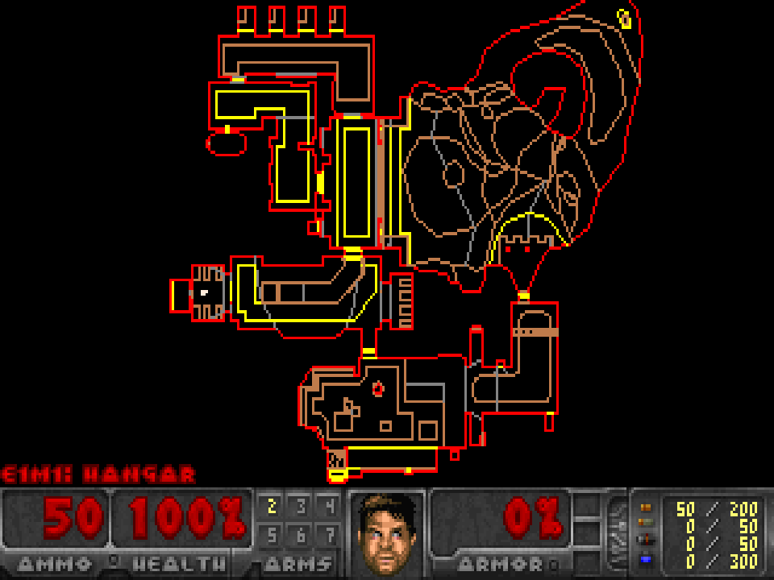
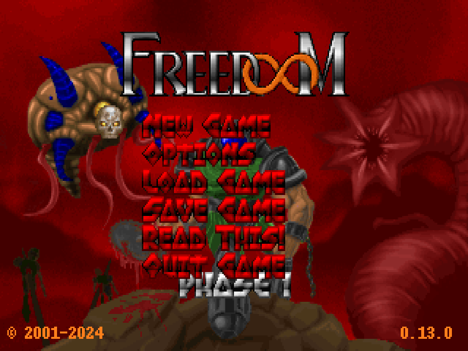

# DoomVB

**DOOM, ported line by line to Visual Basic 6.**

DoomVB is a complete port of id Software's GPL DOOM source release
(`linuxdoom-1.10`) to classic Visual Basic 6: about 29,000 lines of VB, with
one module for every C file of the original. That covers the software
renderer, game logic, monster AI, menus, status bar, automap, intermissions,
finales, sound, music and network play. It compiles to a single native
Windows executable and plays the original game data: DOOM, DOOM II, Final
DOOM or the free [Freedoom](https://freedoom.github.io/) IWADs. Freedoom:
Phase 1 is included, so it runs out of the box.

<!--
  Screenshots: put PNG files in docs/screenshots/ with these names, or change
  the links. Tip: start DoomVB with -devparm and press F1 to save the screen
  as DOOMnn.BMP (320x200) in the game folder.
-->
| | |
|---|---|
|  |  |
|  |  |

## Features

- **Faithful:** the game simulation is the original code, translated
  statement by statement. Demos in the DOOM 1.9 format play back in sync
  (tested with Freedoom's). Builds were compared tic by tic with a per-tic
  state log (`-synclog`).
- **Software renderer:** 320x200, 8-bit, the original column and span
  drawers, scaled up in a window. No DirectX is needed.
- **Sound:** linuxdoom's 8-channel mixer at 44.1 kHz through `waveOut`. It
  plays DOOM's 11 kHz effects and Freedoom's 22/44 kHz effects at their own
  rates.
- **Music:** MUS (the DOOM IWADs) and standard MIDI files (Freedoom), played
  through the Windows MIDI synthesizer.
- **Multiplayer:** 2 to 4 players, co-op or deathmatch, over UDP using
  linuxdoom's own protocol. It includes chat, and recovers from lost packets
  by resending them.
- **Complete front end:** menus, save and load (6 slots), status bar,
  automap, intermission screens, finales, cheats, gamma correction and the
  screen melt.
- **Speed:** about 740 frames per second in `-timedemo demo1` on the
  development PC; the game needs 35.

## Getting started

### Requirements

- Windows. Development and testing were done on Windows 10. The Visual
  Basic 6 runtime (`msvbvm60.dll`) ships with Windows.
- Game data: Freedoom: Phase 1 (`freedoom1.wad`) is included. Any other DOOM
  IWAD works too.

### Game data

`freedoom1.wad` is **Freedoom: Phase 1**, version 0.13.0. It is a free,
BSD-licensed replacement for the DOOM data, with its own levels, art and
music, from the [Freedoom project](https://freedoom.github.io/). Its license
and credits are in the [freedoom/](freedoom/) folder.

To play another IWAD, put it in the same folder as `DoomVB.exe`, or point to
it with `-iwad <file>`. DoomVB uses the first of these files it finds, so an
IWAD you add takes priority over the included Freedoom:

| File | Game |
|---|---|
| `doom2f.wad` | DOOM II (French) |
| `doom2.wad` | DOOM II: Hell on Earth |
| `plutonia.wad` | Final DOOM: The Plutonia Experiment |
| `tnt.wad` | Final DOOM: TNT: Evilution |
| `doomu.wad` | The Ultimate DOOM |
| `doom.wad` | DOOM (registered) / The Ultimate DOOM |
| `doom1.wad` | DOOM shareware |
| `freedoom2.wad` | Freedoom: Phase 2 |
| `freedoom1.wad` | Freedoom: Phase 1 |
| `freedm.wad` | FreeDM |

Freedoom: Phase 2 (`freedoom2.wad`, levels in the DOOM II style) is a free
download from the same site. The shareware `doom1.wad` works too.

### Running

Download `DoomVB.exe` from the [Releases](../../releases) page, or
[build it](#building-from-source), and keep it in the same folder as
`freedoom1.wad`. Double-click it, or start it from a command prompt with
options (see [Command line](#command-line)), for example:

```
DoomVB.exe -warp 1 1 -skill 4
DoomVB.exe -iwad C:\Games\doom2.wad -file mymap.wad -warp 7
```

The window is 640x480 by default (`-scale 3` gives 960x720, `-width <pixels>`
any size). Alt+F4 or closing the window quits.

## Controls

These are DOOM's default keys. Both Ctrl, Shift and Alt keys work. To change
the bindings, edit `default.cfg` (see [Configuration](#configuration)).

### Moving and fighting

| Key | Action |
|---|---|
| Up / Down arrow | Move forward / backward |
| Left / Right arrow | Turn left / right |
| `,` / `.` | Strafe (sidestep) left / right |
| Alt + Left / Right | Strafe left / right |
| Shift (hold) | Run |
| Ctrl | Fire |
| Space | Use: open doors, press switches, ride lifts |
| `1` | Fist / chainsaw |
| `2` | Pistol |
| `3` | Shotgun / super shotgun (DOOM II) |
| `4` | Chaingun |
| `5` | Rocket launcher |
| `6` | Plasma rifle |
| `7` | BFG 9000 |

### Mouse

The mouse is captured while you play in the game window. It is released in
the menus, while paused, and when you switch to another window.

| Mouse | Action |
|---|---|
| Move left / right | Turn |
| Move forward / back | Walk forward / backward |
| Left button | Fire |
| Right button (hold) | Strafe: mouse movement sidesteps instead of turning |
| Middle button | Move forward |
| Double-click right or middle | Use |

Set the mouse sensitivity under Options in the menu. Start with `-nomouse`
to turn the mouse off.

### Menus and function keys

| Key | Action |
|---|---|
| Esc | Open / close the menu |
| Arrows, Enter | Navigate and choose; Left / Right move sliders |
| Backspace | Back to the previous menu |
| Y / N | Answer a question |
| F1 | Help screen |
| F2 / F3 | Save game / load game |
| F4 | Sound volume |
| F5 | Detail: high / low |
| F6 / F9 | Quicksave / quickload |
| F7 | End game |
| F8 | Messages on / off |
| F10 | Quit |
| F11 | Gamma correction (5 levels) |
| F12 | In co-op games and demos: view through the next player's eyes |
| `-` / `=` | Smaller / larger view (full screen at the largest) |
| Pause | Pause |
| Enter | Show the last message again |

### Automap

| Key | Action |
|---|---|
| Tab | Automap on / off |
| `F` | Follow mode on / off (when off, the arrow keys move the map) |
| `-` / `=` | Zoom out / in |
| `0` | Toggle between the whole map and the normal zoom |
| `G` | Grid on / off |
| `M` | Place a marker |
| `C` | Clear all markers |

### Chat (multiplayer)

| Key | Action |
|---|---|
| `T` | Talk to everyone |
| `G` / `I` / `B` / `R` | Talk to the green / indigo / brown / red player (games with 3 or more players) |
| Enter | Send the message |
| Esc | Cancel |
| Alt + `0`...`9` | Send a chat macro (the texts are in `default.cfg`) |

### Cheats

<details>
<summary>Type these during the game (single player)</summary>

| Code | Effect |
|---|---|
| `iddqd` | God mode |
| `idkfa` | All weapons, full ammo, armor and all keys |
| `idfa` | All weapons, full ammo and armor |
| `idspispopd` | Walk through walls (DOOM) |
| `idclip` | Walk through walls (DOOM II) |
| `idbehold` + `v` `s` `i` `r` `a` `l` | Invulnerability, berserk, invisibility, radiation suit, computer map, light amplification |
| `idchoppers` | Chainsaw |
| `idclev` + 2 digits | Go to a level: `idclev12` = E1M2, in DOOM II `idclev07` = MAP07 |
| `idmus` + 2 digits | Change the music |
| `idmypos` | Show your position |
| `iddt` | On the automap: show the whole map; type it again to show things too |

As in linuxdoom, the cheats also work on Nightmare. They don't work in net
games, apart from `iddt` in co-op. Don't use `idclev` in a net game: it
changes the level on your computer only.

</details>

## Multiplayer

DoomVB uses linuxdoom's peer-to-peer UDP protocol. Every player runs
DoomVB, gives their own player number (1 to 4), and lists the IP addresses
of all the other players. Player 1 chooses the game, and the others receive
the skill, map and mode from player 1.

Two players on a LAN, deathmatch on E1M1:

```
PC 1 (192.168.1.10):   DoomVB.exe -net 1 192.168.1.20 -deathmatch -warp 1 1 -skill 4
PC 2 (192.168.1.20):   DoomVB.exe -net 2 192.168.1.10
```

Three players, co-op:

```
PC 1 (192.168.1.10):   DoomVB.exe -net 1 192.168.1.20 192.168.1.30 -warp 1 1
PC 2 (192.168.1.20):   DoomVB.exe -net 2 192.168.1.10 192.168.1.30
PC 3 (192.168.1.30):   DoomVB.exe -net 3 192.168.1.10 192.168.1.20
```

- Start the players in any order. Each one waits, and says so in the window
  title, until everybody is there. Esc cancels the wait.
- Player 1 sets the game with `-skill`, `-episode` / `-warp`,
  `-deathmatch` or `-altdeath` (items respawn), `-nomonsters` and
  `-respawn`. Without `-deathmatch` the game is co-op.
- Every player must give the same `-fast`, `-timer`, `-avg`, `-dup` and
  `-extratic` options and use the same IWAD and `-file` WADs. These are not
  sent over the network, and differences make the games drift apart (DoomVB
  stops with a "consistency failure" message).
- The game uses UDP port 5029. `-port <n>` changes it for your copy. A host
  can be written `address:port` if that player uses a different port.
- The first time, Windows Firewall asks whether DoomVB may receive network
  traffic. Allow it on the network you play on.
- Over the internet every player needs a reachable address (port
  forwarding behind a router). The protocol waits for every player each
  tic, so it plays best on a LAN.
- `-dup 2` sends half as many packets for slow connections. `-extratic`
  repeats each command in the next packet to cover lost packets.
- If a player quits, the others get "Player n left the game" and play on.
- `-debugfile` writes every packet sent and received to
  `debug<player>.txt`, which helps when something goes wrong.
- DoomVB only plays with DoomVB. DOS DOOM (IPX) and other source ports
  (Chocolate Doom and others) use different network code.

### Several players on one PC

Give every copy its own port and address the others as `127.0.0.1:<port>`.
Run each copy from its own folder (with `-iwad`), so that the log files
don't collide:

```
DoomVB.exe -net 1 127.0.0.1:5031 -port 5030 -warp 1 1
copy2\DoomVB.exe -iwad C:\Games\freedoom1.wad -net 2 127.0.0.1:5030 -port 5031
```

## Configuration

DoomVB keeps its files in the folder of `DoomVB.exe`:

| File | Contents |
|---|---|
| `default.cfg` | Settings and key bindings, saved when you quit. `-config <file>` uses another file. |
| `doomsav0.dsg` ... `doomsav5.dsg` | Savegames (DoomVB's own format, not compatible with DOS DOOM) |
| `DOOMnn.BMP` | Screenshots: start with `-devparm` and press F1 |
| `doomvb.log` | Startup messages and errors |

Key bindings in `default.cfg` use DOOM's key codes: a letter or digit is its
lowercase ASCII code. Special keys:

| Key | Code | | Key | Code |
|---|---|---|---|---|
| Right arrow | 174 | | Ctrl | 157 |
| Left arrow | 172 | | Shift | 182 |
| Up arrow | 173 | | Alt | 184 |
| Down arrow | 175 | | Space | 32 |

The bindings are `key_right`, `key_left`, `key_up`, `key_down`,
`key_strafeleft`, `key_straferight`, `key_fire`, `key_use`, `key_strafe`
and `key_speed`. Mouse buttons are `mouseb_fire`, `mouseb_strafe` and
`mouseb_forward`, where 0 = left, 1 = right and 2 = middle.

## Command line

### Game options (as in DOOM)

| Option | Effect |
|---|---|
| `-iwad <file>` | Use this IWAD instead of searching the game folder |
| `-file <wad> ...` | Load PWADs (custom levels and replacements) |
| `-warp <e> <m>` / `-warp <m>` | Start on episode e, map m (DOOM II: map m) |
| `-episode <n>` | Start on episode n |
| `-skill <1-5>` | 1 = I'm too young to die ... 5 = Nightmare! |
| `-nomonsters` | No monsters |
| `-respawn` | Monsters respawn |
| `-fast` | Fast monsters |
| `-turbo [n]` | Move at n % speed (default 200) |
| `-deathmatch` / `-altdeath` | Deathmatch / deathmatch 2.0 (items respawn) |
| `-timer <min>` / `-avg` | Deathmatch: exit the level after n minutes / after 20 minutes |
| `-loadgame <n>` | Load savegame slot n at startup |
| `-record <name>` | Record a demo to `<name>.lmp` (`-maxdemo <kb>` for longer ones) |
| `-playdemo <name>` | Play a demo (a `.lmp` file or a demo lump) |
| `-timedemo <name>` | Play a demo as fast as possible and report the frame rate (`-nodraw`, `-noblit`) |
| `-nosound` / `-nosfx` / `-nomusic` | No sound at all / no sound effects / no music |
| `-config <file>` | Use another configuration file |
| `-devparm` | Development mode: F1 saves a screenshot |
| `-net <n> <host> ...` | Network game, see [Multiplayer](#multiplayer) |
| `-port <n>` / `-dup <n>` / `-extratic` / `-debugfile` | Network options |

### DoomVB options

| Option | Effect |
|---|---|
| `-scale <n>` | Window size: 320 x n wide (default 2) |
| `-width <pixels>` | Window width (the height follows at 4:3) |
| `-nomouse` | Don't use the mouse |

### Testing and debugging options

These exist for automated testing of the port and are documented in
[docs/CONVENTIONS.md](docs/CONVENTIONS.md):
`-hidden`, `-shot <tic> <file.bmp>`, `-quitat <tic>`, `-exitat <tic>`,
`-key <tic>[+n] <key>`, `-synclog <file>`, `-checklinks`, `-watch <slot>`,
`-sndcapture <file.wav>`, `-muslog <file>` and `-netdrop <n>`.

## Known limitations

- Windowed only: no fullscreen mode, and no joystick support.
- Savegames are not compatible with DOS DOOM.
- Most testing used Freedoom. The DOOM II cast call at the end of the game,
  and music from the commercial IWADs (MUS format), have only been tested
  with Freedoom's MIDI music and a hand-made MUS song.
- Multiplayer was tested with several copies on one PC; reports from real
  LAN games are welcome.

## Building from source

You need **Microsoft Visual Basic 6.0** and **Python 3**.

```
python tools\build.py              build DoomVB.exe
python tools\build.py --release    the same, without array bounds checks
python tools\debugbuild.py         DoomVB_debug.exe: run time errors log a call trace
python tools\check_names.py        find VB name clashes (VB is case-insensitive)
python tools\gen_tables.py         regenerate the data tables from the C source
```

`build.py` writes `DoomVB.vbp` from the files in `src/`, compiles the
resource file and runs `VB6.EXE /make`. It expects VB6 in
`C:\Program Files (x86)\Microsoft Visual Studio\VB98\`; change the `VB6` and
`RC` paths at the top of the script if yours is elsewhere. You can also open
`DoomVB.vbp` in the VB6 IDE.

The project is compiled to native code with **No Optimization**. VB6's
"Optimize for Fast Code" setting miscompiled one routine, and the build is
fast enough without it.

| Folder | Contents |
|---|---|
| `src/` | The VB6 source: one module per C file of linuxdoom, plus `frmDoom.frm` |
| `tools/` | Build, debug and table generator scripts |
| `res/` | Resource script; `tables.bin` holds the generated lookup tables |
| `docs/` | [CONVENTIONS.md](docs/CONVENTIONS.md) (how the C maps to VB6, VB6 pitfalls) and [RESUME.md](docs/RESUME.md) (status, test methods, every deviation) |
| `stubs/` | Interface stubs used while the port was built cluster by cluster (no longer compiled) |
| `freedoom/` | License and credits of the included `freedoom1.wad` |
| `ref/linuxdoom-1.10/` | The original C source, for reference |

## Differences from linuxdoom

DoomVB follows the C code closely. The changes, all marked in the source and
listed in [docs/RESUME.md](docs/RESUME.md), are mostly Windows parts and
fixes for crashes or plain bugs:

- New Windows layers for video (GDI), sound (`waveOut`), music (the
  `midiStream` API) and network (Winsock). linuxdoom's sound used `/dev/dsp`,
  and its music code did nothing.
- Engine limits grow as needed: visplanes, drawsegs, sprites and more.
- Guards against crashes that the C would hit.
- Sound effects use the DOS volume scale. Sounds stop and follow moving
  sources as in DOS, where linuxdoom left those functions empty.
- `idclev` works in DOOM II.
- Several players can run on one PC, and a few other small changes.

Savegames use DoomVB's own format.

## License

DoomVB is free software, licensed under the **GNU General Public License,
version 2**; see [LICENSE.TXT](LICENSE.TXT). It is a derivative of the DOOM
source code by id Software, which id released under the GPL in 1999.

The included `freedoom1.wad` is Freedoom: Phase 1 0.13.0, Copyright ©
2001-2024 Contributors to the Freedoom project. It is a separate work,
distributed under the BSD license in
[freedoom/COPYING.txt](freedoom/COPYING.txt) rather than under the GPL. The
contributors are listed in [freedoom/CREDITS.txt](freedoom/CREDITS.txt) and
[freedoom/CREDITS-MUSIC.txt](freedoom/CREDITS-MUSIC.txt).

DOOM, DOOM II and Final DOOM are commercial games by id Software. Their data
is not included.

DoomVB is not affiliated with or endorsed by id Software, ZeniMax Media or
Bethesda. DOOM is a registered trademark of id Software LLC.

## Credits

- **id Software**: DOOM, and the source code release (linuxdoom-1.10 was
  prepared by Bernd Kreimeier).
- **The Freedoom project**: the free game data included with DoomVB and
  used to develop and test it.
